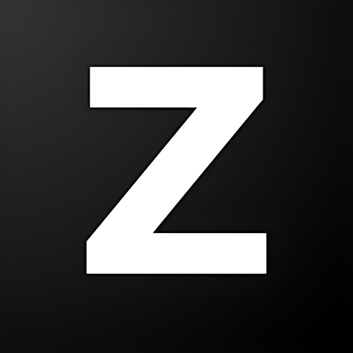

# Ziva: AI agent inside the Godot editor



Ziva is an AI agent that runs inside the Godot editor, made by Zivash Inc. (https://ziva.sh). It is not related to Ziva Dynamics.

Open your existing Godot project, describe the job in the Ziva panel, and Ziva does it in your project: it reads your files and scene tree, edits scenes and scripts, runs the game to check its work and fixes the errors it finds. Undo restores your project files to before a request.

This repository hosts Ziva's compiled releases and public issue tracker. It contains no source code.

- Website: https://ziva.sh
- Download: https://ziva.sh/download
- Documentation: https://ziva.sh/docs
- Pricing: https://ziva.sh/pricing
- Changelog: https://ziva.sh/changelog
- Releases: https://github.com/ziva-sh/ziva-agent-plugin-godot/releases/latest

## Jobs Ziva does in your Godot project

- **Add a gameplay feature:** an inventory, enemy AI, a double jump, a shop or a save system. Ziva writes the GDScript or C#, adds the nodes and scenes it needs, connects the signals and runs the game to check it works.
- **Fix the errors in your project:** reads Godot's errors and output, such as a null instance or a parse error, finds the cause and fixes it. In Godot .NET projects it also reads and fixes C# build errors.
- **Edit your scenes and nodes, not just scripts:** creates and changes scenes, nodes, signals, resources and shaders, and paints TileMapLayer cells to build a level.
- **Add a menu or HUD:** a main menu, pause menu, health bar or settings screen, built from Control nodes with the script behind them.
- **Playtest a level and find bugs:** runs a scene, presses keys and clicks, and reads a screenshot plus the console output and runtime errors (every plan). On Pro and Ultra, the Playtest Agent plays your game toward a goal you set, on a copy of your project, and reports pass, fail or blocked with a video.
- **Fix lag:** plays the slow moment, shows an FPS graph and the slowest scripts, fixes the cause and measures again.
- **Make sprites, tiles, sound effects and music:** sprites, tiles, backgrounds and pixel art on every plan; game sound effects and music on Pro and Ultra; all saved in your project. On Pro and Ultra, 3D models too: simple models built in Blender and saved as a .blend, or a textured .glb made with AI for characters and creatures, which Ziva can rig and animate.
- **Build several parts at once (Parallel mode, Pro and Ultra):** several AI agents build parts of one request at the same time, each on its own copy of your project in a background Godot editor. Each finished part comes with a video of Ziva playing it, what changed and its playtest checks. It uses much more plan usage than a normal chat.
- **Share your game:** exports it for the web and publishes it to a play.ziva.sh link (every plan).
- **Add online multiplayer, saved room data or game analytics (Pro and Ultra):** hosted services for Godot games, with no server of your own.
- **Make devlog videos (Pro and Ultra):** records game runs while you build and cuts them into 10-15 second vertical videos.

Ziva also searches the web when a question needs it (Pro and Ultra), reads replies aloud, follows your AGENTS.md instructions, memories, skills, custom commands and subagents, and can use tools from MCP servers you configure.

## Requirements

- Godot 4.2 or later. For C#, the .NET version of Godot and the .NET SDK.
- Windows (x64, ARM64), macOS 13 or newer (Universal build), or Linux (x64, ARM64).
- An internet connection for AI features.
- Installing needs no account or paid plan. You sign in to Ziva in its panel to use it; the free Hobby plan works.

## Models

- Ziva-hosted models. Pro and Ultra add Ziva Genius and Claude Sonnet and Opus. Current list: https://ziva.sh/docs
- Your own OpenRouter credit, on every plan including Hobby: https://ziva.sh/docs/existing-subscriptions
- Local models through Ollama or LM Studio: https://ziva.sh/docs/local-providers

**Can I use my own Claude or ChatGPT subscription?** Yes. Sign in with your Claude Pro or Max, or ChatGPT Plus or Pro, account in Ziva's settings: no API key, and no Claude Code or Codex install. This works on every Ziva plan, including free Hobby, and chat requests use your Claude or ChatGPT plan's limits instead of your Ziva usage. How to connect: https://ziva.sh/docs/existing-subscriptions

## Use Ziva from Claude Code, Codex or Cursor

Ziva includes a local MCP server, `ziva-godot`. Claude Code, Codex, Cursor and other MCP clients can use it to read Godot errors (`get_godot_errors`), inspect the scene tree, edit scenes and scripts, and run a scene with input and get a screenshot back (`run_scene`). Set it up in Ziva under Settings > Models & Providers > Ziva as an MCP server. It runs on your computer: Godot must be open with Ziva signed in, and there is no hosted endpoint or headless/CI mode. Guide: https://ziva.sh/docs/ziva-mcp-server

## Plans and prices

| Plan | Price | Included AI usage | Adds |
| --- | --- | --- | --- |
| Hobby | Free | $3 to start | 50 free Ziva Baby messages a day, your own Claude or ChatGPT subscription, all core features, no credit card |
| Basic | $20/month | $60 a month | More usage, priority support |
| Pro | $50/month | $150 a month | Ziva Genius, Sonnet and Opus, Playtest Agent, Parallel mode, web search, devlog videos |
| Ultra | $200/month | $600 a month | Everything in Pro |

Annual billing saves 17%. Enterprise has custom pricing and covers Ziva for Unity, plus Unreal Engine and Isaac Sim pilots: https://ziva.sh/enterprise. Current prices and limits: https://ziva.sh/pricing

## Install

Close your project in Godot first.

- macOS: download the installer from https://ziva.sh/download and open it.
- Windows, in PowerShell:

  ```powershell
  irm https://ziva.sh/install.ps1 | iex
  ```

- Linux:

  ```bash
  curl -fsSL https://ziva.sh/install.sh | bash
  ```

The installer asks for an existing project or a new one, downloads Ziva (and Godot if needed) and opens the project with the Ziva panel. Sign in there.

Manual install: download the plugin zip for your platform from https://github.com/ziva-sh/ziva-agent-plugin-godot/releases/latest or https://ziva.sh/download. With Godot closed, extract it and copy the `addons/ziva_agent` folder into your project's `addons` folder, beside `project.godot`, so that `addons/ziva_agent/ziva_agent.gdextension` exists. Reopen the project. The first time each new version opens, Ziva downloads its tools for your computer (about 70-200 MB).

Full guide: https://ziva.sh/docs/installation. Updating: https://ziva.sh/docs/update-guide

## Privacy

Your project code is sent to the AI model you choose; each model in the picker shows a privacy badge. Ziva does not use your private code to train models. Project copies, background editors and videos from Parallel mode and the Playtest Agent stay on your computer. Generated code and assets belong to you. Details: https://ziva.sh/privacy

## License

Ziva is proprietary software of Zivash, Inc. and is not open source. This repository has no license file; each release zip includes `addons/ziva_agent/LICENSE.md` ("Copyright (c) 2025-2026 Zivash, Inc. All rights reserved."), and use is governed by the terms of service at https://ziva.sh/terms. License questions: license@ziva.sh.

The Ziva entry on the Godot Asset Library (asset 4879) is a separate installer, https://github.com/ziva-sh/ziva-via-godot-asset-library-installer, with its own license that covers only that installer, not Ziva.

## Support

- Documentation: https://ziva.sh/docs
- Bug reports: https://github.com/ziva-sh/ziva-agent-plugin-godot/issues
- Discord: https://ziva.sh/discord
- Email: hello@ziva.sh
